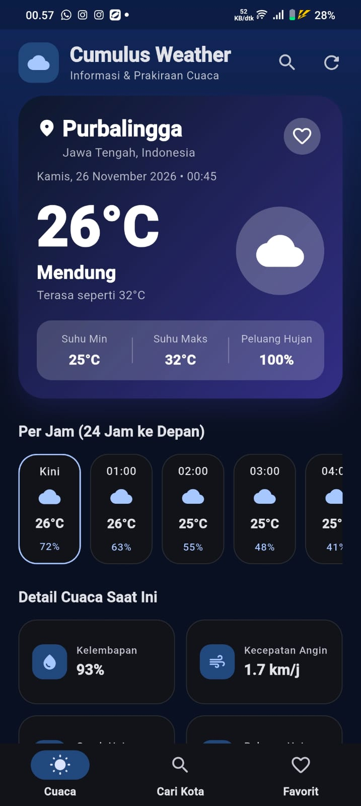
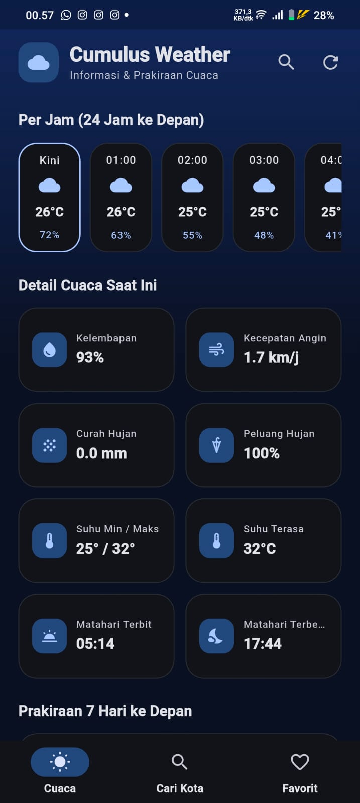
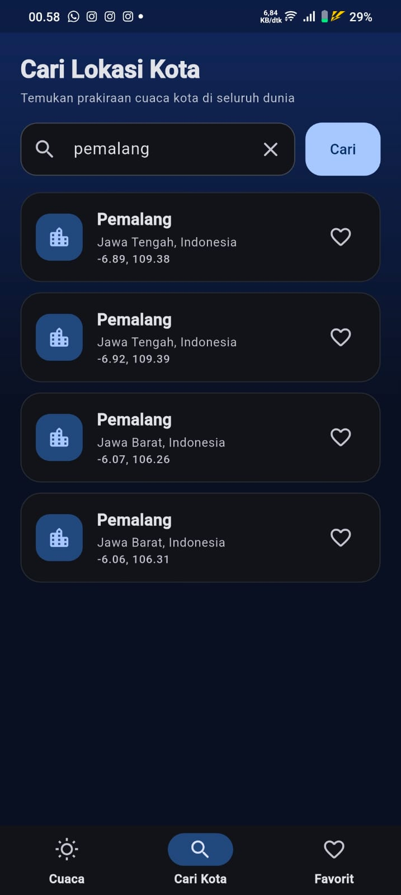
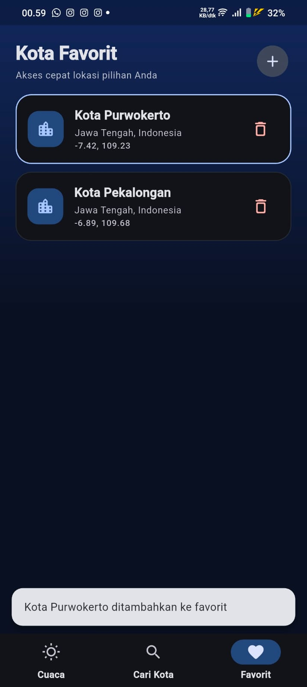

# ☁️ Cumulus Weather

Aplikasi cuaca Flutter untuk **Responsi Praktikum Pemrograman Mobile**.

| | |
|---|---|
| **Nama** | Yunan Faila Sofi |
| **NIM** | H1D024033 |
| **Stack** | Flutter · Dart · Provider (MVVM) · Open-Meteo API · SharedPreferences |

## Screenshot

| Halaman Cuaca Utama | Prakiraan Harian | Pencarian Kota | Kota Favorit |
|---|---|---|---|
|  |  |  |  |

> Ganti file di folder `screenshots/` dengan screenshot asli dari emulator/HP Anda (nama file harus sama).

## Fitur

- Cuaca terkini: kota, suhu, kondisi cuaca, kelembapan, kecepatan angin, curah hujan, peluang hujan, suhu terasa
- Prakiraan per jam (24 jam) dan harian (7 hari) + matahari terbit/terbenam
- Pencarian kota lewat **Geocoding API** (request nyata ke API)
- Simpan / hapus kota favorit (swipe untuk hapus) dan **riwayat pencarian** — tersimpan di local storage
- Kota terakhir dipilih dibuka kembali saat aplikasi dijalankan
- Kartu utama berubah warna sesuai cuaca & siang/malam, mendukung **Light & Dark mode**
- Pull-to-refresh, state **loading / kosong / error** + tombol coba lagi

## Cara Menjalankan

```bash
# 1. Buat folder platform (android/ios/web) di dalam project ini
flutter create . --project-name cumulus_weather --org id.ac.unsoed

# 2. Ambil dependency
flutter pub get

# 3. Jalankan
flutter run
```

> Android rilis (`flutter build apk`) membutuhkan izin internet. Pastikan di
> `android/app/src/main/AndroidManifest.xml` ada baris berikut sebelum `<application>`:
> `<uses-permission android:name="android.permission.INTERNET"/>`

## Struktur Project (MVVM)

```
lib/
├── main.dart                      # entry point, MultiProvider, tema
├── core/
│   ├── theme/app_theme.dart       # Theme Material 3 (light & dark), typography
│   └── utils/weather_code.dart    # weather_code -> teks, ikon, gradien
├── data/
│   ├── models/                    # MODEL: CityLocation, WeatherData (fromJson)
│   ├── services/
│   │   ├── weather_api_service.dart   # HTTP GET ke Open-Meteo
│   │   └── local_storage_service.dart # SharedPreferences
│   └── repositories/weather_repository.dart
├── viewmodels/                    # VIEWMODEL (ChangeNotifier)
│   ├── weather_viewmodel.dart
│   ├── search_viewmodel.dart
│   ├── favorites_viewmodel.dart
│   └── navigation_viewmodel.dart
└── views/                         # VIEW (widget saja, tanpa logika bisnis)
    ├── main_shell.dart            # bottom navigation
    ├── home_screen.dart
    ├── search_screen.dart
    ├── favorites_screen.dart
    └── widgets/
```

## Penerapan MVVM

| Lapisan | Tanggung jawab | File |
|---|---|---|
| **Model** | Struktur data + parsing JSON ke objek Dart | `data/models/*` |
| **View** | Menampilkan UI dan meneruskan aksi pengguna ke ViewModel | `views/*` |
| **ViewModel** | Menyimpan state (`loading/success/empty/error`), memanggil repository, `notifyListeners()` | `viewmodels/*` |

Alur data: `View → ViewModel → Repository → (ApiService | LocalStorageService)` lalu hasilnya
kembali ke View lewat `context.watch<...>()` sehingga UI otomatis dibangun ulang (*recomposition*).

## Implementasi API (Open-Meteo)

**Geocoding** — `GET https://geocoding-api.open-meteo.com/v1/search?name={kota}&count=10&language=id`

**Forecast** — `GET https://api.open-meteo.com/v1/forecast`

| Parameter | Nilai |
|---|---|
| `latitude`, `longitude` | dari kota yang dipilih |
| `current` | `temperature_2m, relative_humidity_2m, apparent_temperature, precipitation, weather_code, wind_speed_10m, is_day` |
| `daily` | `weather_code, temperature_2m_max, temperature_2m_min, precipitation_probability_max, sunrise, sunset` |
| `hourly` | `temperature_2m, precipitation_probability, weather_code` |
| `timezone` | `auto` |

Respons JSON diubah menjadi model Dart di `WeatherData.fromJson`. Kegagalan jaringan, timeout,
status selain 200, dan format JSON salah ditangkap sebagai `ApiException` dan ditampilkan di UI.

## Checklist Ketentuan Responsi

| Ketentuan | Implementasi |
|---|---|
| Flutter + Dart, Stateful & Stateless | `SearchScreen` (Stateful), widget lain Stateless |
| Material Design, Theme, Typography, responsif | `AppTheme` (Material 3), `ListView`/`GridView`/`Expanded` |
| Local storage favorit & riwayat, tampil lagi saat dibuka | `LocalStorageService` (SharedPreferences) |
| State management | Provider + ChangeNotifier |
| Cari kota & tampilkan cuaca kota terpilih | `SearchViewModel` → `WeatherViewModel.selectCity` |
| REST API Open-Meteo, HTTP GET, JSON → model | `WeatherApiService`, `WeatherData.fromJson` |
| Loading, kosong, error | `ViewStatus`, `SearchStatus`, `state_views.dart` |
| MVVM | Lihat tabel di atas |
| Screen minimal 2 | Cuaca, Cari Kota, + Favorit |
| Data dari API, bukan hardcoded | Semua data cuaca & hasil pencarian dari request nyata |

## Catatan Pengumpulan

- [ ] Push source code ke GitHub
- [ ] Ganti screenshot di folder `screenshots/`
- [ ] Rekam video penjelasan kode
- [ ] Kirim link lewat form sebelum **26 November 2026 pukul 10.00**
